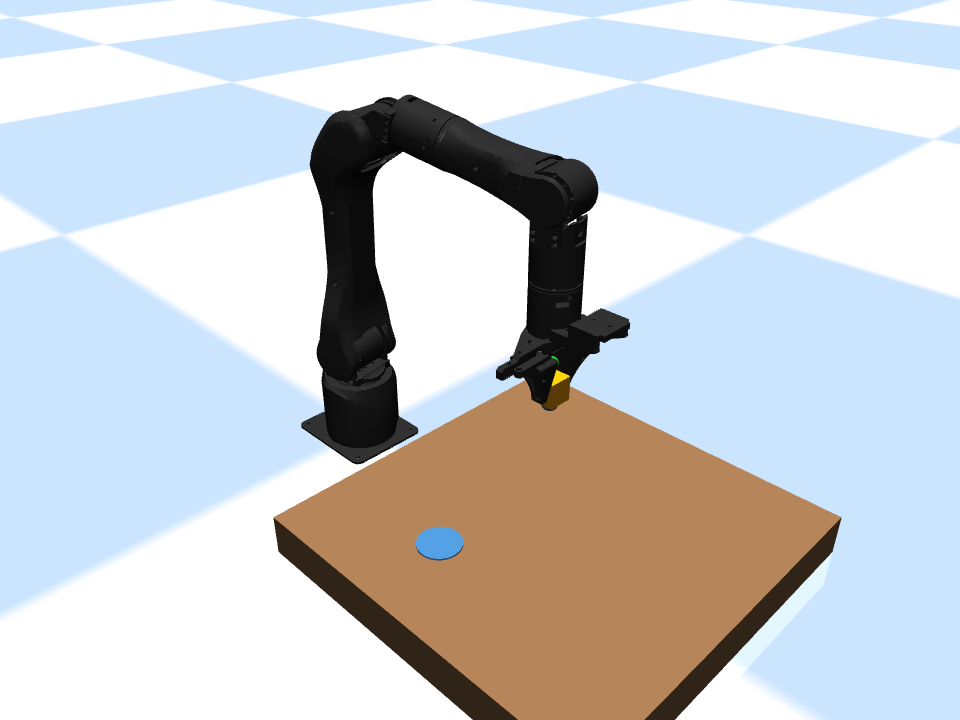

# Alicia-M MuJoCo Learning Lab

An early-stage robotics learning project: a six-axis Alicia-M arm picks and places a free cube through simulated physical contact. Includes Chinese teaching comments, coordinate inputs, contact feedback, failed-grasp recovery, tracking logs, and a three-position batch runner.

这是从本地学习环境整理的首个公开源码版本，重点是**可复现的 MuJoCo 接触抓放与失败记录**。目前没有公开用户量或广泛采用的证据；不是官方 SDK，也不包含已完成的强化学习策略。



*Actual image from the 2026-10-21 release validation. Simulation only.*

## Quick start / 快速运行

Python 3.11 is the initial validation target. Run from the repository root:

```powershell
python -m venv .venv
.venv\Scripts\python -m pip install -r requirements.txt
.venv\Scripts\python desktop_pick_place/step03_coordinates.py
```

Linux/macOS: use `.venv/bin/python` instead of `.venv\Scripts\python`. Those platforms have not been verified for this release. The GUI requires a working OpenGL/display setup; headless runs still render images and require a supported graphics backend.

```powershell
# Three independent, selected positions; saves images, raw logs, and summary.json/csv
.venv\Scripts\python desktop_pick_place/step05_batch.py
# Deliberately keep the gripper open: expected task failure, retreat, and exit code 1
.venv\Scripts\python desktop_pick_place/step04_feedback.py --headless --demo-empty-grasp
# Existing regression tests, including the physical failed-grasp experiment
.venv\Scripts\python -m unittest discover -s desktop_pick_place/tests -v
```

## What to read

- `desktop_pick_place/step03_coordinates.py`: pick/place object-center XYZ, in meters.
- `desktop_pick_place/pick_place.py`: waypoints, IK, smooth motion, grasp checks, and final-state checks.
- `desktop_pick_place/scene.py`: table, free cube, gripper geometry, and contact forces.
- `desktop_pick_place/LESSON04.md` / `LESSON05.md`: feedback and batch experiments.
- `simulation/alicia_m.py`: model loading and teaching position servo.

The detailed local course README is retained in `desktop_pick_place/README.md`. Its D-drive environment paths describe the original workstation; use the root instructions above on a new machine. Results are generated in `desktop_pick_place/results/` and ignored by Git.

## Model source and dependencies

Robot assets are loaded from [Synria Robotics robot descriptions](https://github.com/Synria-Robotics/Synria-robot-descriptions), through the separately installed `synriard` package. No upstream SDK, meshes, or model distribution is bundled here. See [THIRD_PARTY.md](THIRD_PARTY.md). The existing loader prefers a local model at `D:/MuJoCo/models/Alicia_M/mjcf/Alicia_M_v1_1/Alicia_M_v1_1_follower.xml` if present; otherwise it uses the `synriard` package. Release validation explicitly exercises the package model to avoid depending on that local path.

## Evidence and limits

Successful grasp requires contact on both fingers, lift of the free cube, transport, release, and final settling near the target. Open/close commands alone do not qualify. An unconfirmed grasp triggers opening and vertical retreat; recovery does not change a failed task into success.

This is deterministic **simulation evidence only**. The model uses teaching position servos and ideal external gravity support; contact settings have not been identified on hardware. Three selected passing positions do not establish general reliability. Paths are sampled for collision checks and are not a general continuous collision planner. No hardware serial connection or real-arm execution is performed by the included demo.

Future work may explore control/dynamics and reinforcement learning. Those are plans, not completed results. See [docs/VALIDATION.md](docs/VALIDATION.md) for this release's actual checks.

## Contributing and license

Reproducible bug reports and small documented improvements are welcome; see [CONTRIBUTING.md](CONTRIBUTING.md). Project code is released under the MIT License. External models and dependencies retain their own licenses.
