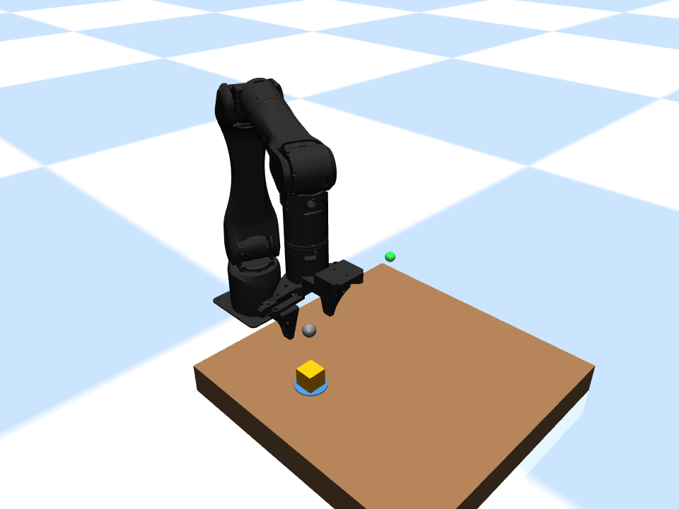

# Release validation — 2026-10-21

Executed against this exported source tree on Windows with Python 3.11.9, MuJoCo 3.16.0, synriard 1.2.4, NumPy 2.4.6, SciPy 1.17.1, and Matplotlib 3.11.2. Existing local dependency environment was reused; this was not a fresh-environment installation test.

## Regression tests

**7 tests passed**, including the real MuJoCo empty-grasp failure/retreat experiment, IK pose, gripper opening geometry, free-cube scene, object-state preservation during path checks, coordinate propagation, and invalid-input rejection.

Test discovery: `python -m unittest discover -s desktop_pick_place/tests -v`.

For this release run, `simulation.alicia_m.source_model_path` was patched in memory with `unittest.mock.patch` to return the installed synriard follower model, rather than using the workstation's preferred D-drive model. No simulation behavior or on-disk model was patched. All subsequent tests and batch tasks used that same package model.

Package MJCF SHA256: `2a5a4b989a6ba4c06de242ce7fe8f9309e66e17400dd30f3c3f7d20122af9bd2`.

## Complete physical-contact task

`step05_batch.run_batch(...)` completed **3/3 selected positions**, using separate scenes and the package model above.

| Selected case | Result | Simulated duration (s) | Final object XY error (mm) |
| --- | --- | ---: | ---: |
| original | pass | 16.15 | 0.03834 |
| shifted | pass | 16.15 | 0.04062 |
| diagonal | pass | 16.15 | 0.04283 |

Reports are in [evidence/](evidence/). Every report preserves the bilateral contact measurements, lift evidence, final object state, warnings, and result scope. These very small errors reflect this teaching simulation, including ideal gravity support; they do not establish hardware precision. Runtime duration is simulation time, not measured wall-clock latency.

## Publication checks and limits

The staged text/source files were scanned for common credential formats, private-key blocks, and non-empty secret assignments. No matches were found. Runtime results, virtual environments, and local logs are ignored. This pattern scan is not a proof of absence of every possible secret.

No real arm was connected. No RL policy, broad reliability evaluation, clean install, Linux/macOS run, or continuous collision-safety guarantee is claimed. Passing three chosen deterministic cases does not estimate a general success rate.
